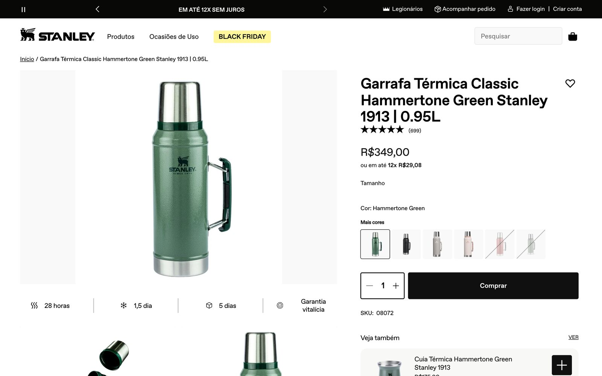
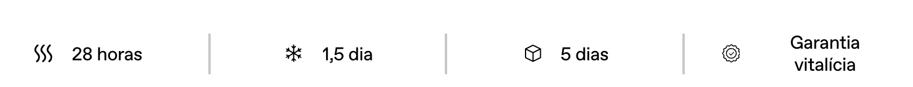
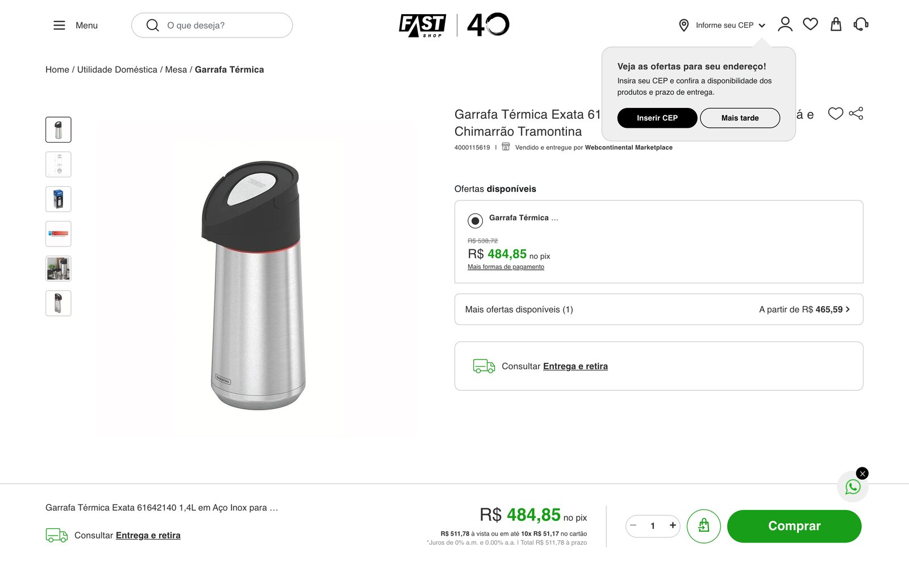
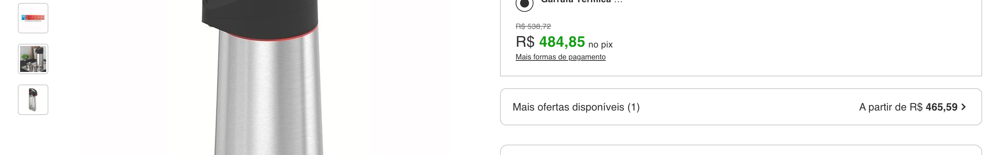
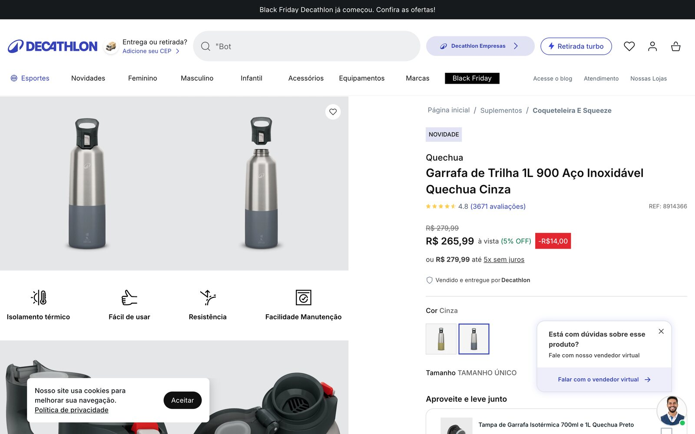
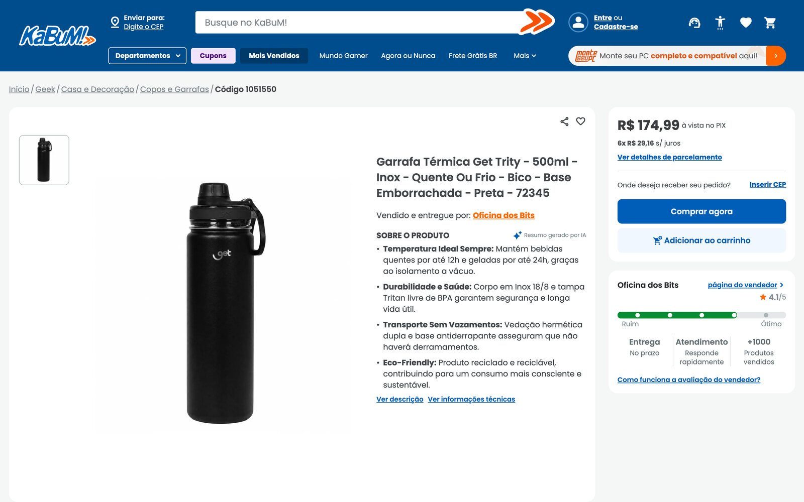

# Casos reais

Quatro páginas de garrafa térmica, em quatro lojas e três plataformas, lidas em 09/11/2026 com o
mesmo conferidor e a mesma régua. A ideia não é apontar erro de ninguém: é mostrar, em lojas de
verdade, o que dá para melhorar. As páginas mudam; os números valem para a data da leitura.

Cada página foi lida de dois jeitos: o HTML que a loja entrega (o que um robô sem navegador recebe)
e a página depois do JavaScript (o que você vê). Os prints são da página pública. O HTML das lojas
não está neste repositório: para refazer, salve a página no seu navegador.

| # | Loja | Plataforma | SEO | O que mais dá para melhorar |
|---|---|---|---|---|
| 01 | Stanley, loja oficial | Shopify | 66 | a página diz 28 horas e 24 horas para a mesma coisa |
| 02 | Fast Shop | VTEX | 78 | especificações num parágrafo só |
| 03 | Decathlon | VTEX | 84 | nota 4,8 de 3.671 avaliações visível, mas fora do schema; schema sem marca |
| 04 | KaBuM | própria | 64 | o título da página é de promoção, não do produto |

**O que se repetiu:** nenhuma das quatro tem pergunta de comprador respondida no HTML que a loja
entrega, nenhuma declara frete no schema, e três de quatro não têm especificações em pares
atributo: valor.

## 01 · Stanley, Garrafa Térmica Classic 0,95 L

`stanley1913.com.br/products/garrafa-termica-classic-hammertone-green-0-95l`

**O que já está bom:** conteúdo e schema no HTML inicial, 8 especificações em pares, endereço
legível, canonical, Open Graph e meta com fatos.

**O que dá para melhorar:**

1. **A página se contradiz.** No topo: quente por 28 horas, gelado por 1,5 dia. Nos detalhes: até
   24 horas para os dois. Um assistente que lê a página não sabe qual número repetir (G04).

   
   

2. **A nota 4,9 de 699 avaliações só entra no schema depois do JavaScript.** Os robôs de IA
   medidos não executam JavaScript (S15).
3. **Preço no schema com vírgula: `"349,00"`.** O schema.org pede ponto (`349.00`) (S06).
4. **Título sem "térmica":** "Garrafa Classic Hammertone Green 0,95L – Stanley 1913 BR" (S01).
5. **Sem GTIN, sem frete no schema e sem `ProductGroup`** para as outras cores (S09, S10, S16).
6. **Nenhuma pergunta de comprador** respondida na página (G08).

**Depois do time** (simulação educativa feita a partir da página pública, não é a página oficial):
SEO 66 para 94 e GEO 71 para 100, medidos pelo conferidor. O time não escolheu entre 28 e 24 horas:
tirou as horas e deixou a pergunta para a marca, junto com uma "Dimensões: 31 mm" que não diz o que
mede.

## 02 · Fast Shop, Garrafa Térmica Tramontina Exata 1,4 L

`site.fastshop.com.br/garrafa-termica-exata-61642140-14l-em-aco-inox-para-cha-e-chimarrao-tramontina-181106/p`

**O que já está bom:** schema `Product` completo, GTIN válido com marca, trilha e categoria.

**O que dá para melhorar:** as especificações estão num parágrafo só, separadas por ponto e
vírgula (G02); a página tem dois H1 iguais (S03); a meta description é a descrição inteira, com
1.757 caracteres; o schema declara 10 mil unidades disponíveis, enquanto a página limita a compra
a 5; nenhuma pergunta respondida (G08).

## 03 · Decathlon, Garrafa de Trilha 1 L 900 Quechua

`decathlon.com.br/garrafa-900-termica-inox-1l-com-tampa-cinza-8914366-quechua/p`

**O que já está bom:** 84 de 100 em SEO. Schema com preço e estoque, GTIN, variantes marcadas,
todas as fotos com texto alternativo.

**O que dá para melhorar:** a nota 4,8 de 3.671 avaliações aparece na página, mas não está no
schema (S15); o schema do produto não tem marca (S09); o nome não diz "térmica" (S01); as
especificações não estão em pares (G02).

## 04 · KaBuM, Garrafa Térmica Get Trity 500 ml

`kabum.com.br/produto/1051550/garrafa-termica-get-trity-500ml-inox-...`

**O que já está bom:** schema com preço e estoque, conteúdo no HTML inicial, H1 com o produto.

**O que dá para melhorar:** o `<title>` da página é "Produtos com até 15 OFF no PIX | KaBuM", um
título de promoção que não nomeia o produto (S01); a meta não traz nenhum fato do produto (S02);
sem frete e devolução no schema (S10); especificações sem pares (G02).
